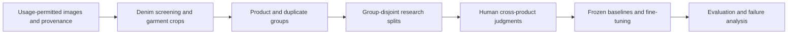

# Denim Atlas

**Fine-tuning a vision encoder for visible denim appearance similarity across different products.**

사진 속 데님의 색·톤·페이딩·워싱·실루엣을 기준으로, 다른 상품에서도 비슷한 외관을 찾는 모델을 연구합니다.

**Status — October 24, 2026:** remote model execution is verified; fixed-pool evaluation and B0/B1 ranking pass local synthetic tests. A pinned remote feature extractor is prepared but not yet run. Real-data fine-tuning and retrieval evaluation have not started.

## From the original idea to this study

The starting idea was an image-driven denim discovery service: give it a reference photograph and find products with similar visual characteristics. A longer-term wardrobe and styling application was discussed, but the immediate technical question was whether denim similarity could be represented well enough to support that service.

| Stage | Decision | Consequence |
|---|---|---|
| Initial concept | Retrieve visually similar denim, including a different product | Product identity is not the retrieval target |
| Reference exploration | Use ten photographs to distinguish surface appearance from silhouette | Record supported comparison facets; examples are not relevance labels |
| Scope clarification | Match the input image rather than the author's personal taste | Preferred brands, cool tones and mild fading must not become universal filters |
| Appearance definition | Preserve visible lighting, washing and wear | Do not reconstruct original fabric color or a pre-fading state |
| Research refocus | Establish adaptation and independent evaluation before an application | Mobile UI, usability studies, pricing and shopping integration are deferred |
| Compute constraint | Use an older laptop for editing and small tests | Run model downloads, image processing and training on free remote compute |
| Current milestone | Verify model loading, gradients, checkpoint handling and metadata processing | Build usable data and human judgments before fine-tuning |

The project starts from a pretrained encoder. Training a foundation model from scratch is outside its scope. The intended result is a reproducible applied-ML experiment: provenance, an annotation protocol, baselines, a fine-tuned checkpoint where distribution is permitted, and an honest comparison on unseen product groups. Architectural novelty is not assumed.

## Research question and matching target

> Can fine-tuning on human judgments of denim appearance improve cross-product ranking on unseen products over the frozen starting checkpoint and a simple color-reranking control?

The observations are color/tone, fading strength and location, wash-pattern appearance, and silhouette. Different products can be close matches. The same product after substantial fading can be a poor match to an earlier photograph.

Lighting-induced color is part of the observation. A photograph taken under similar lighting can be a valid match. Estimating the illuminant or recovering physical fabric color is not required. Background similarity is not a substitute for comparing the denim region.

Silhouette and surface appearance are separate facets. A partially hidden or side-view photograph may not support every judgment. Keep unobservable facets explicit instead of inventing labels. The ten initial reference photographs are not bundled with this repository and do not constitute a training or evaluation set.

## Planned experiment



| Method | Role | Status |
|---|---|---|
| Generic `timm/ViT-B-16-SigLIP` (224) | General-purpose comparator | Selected; not executed |
| B0: frozen Marqo fashionSigLIP | Main starting checkpoint | Synthetic inference verified; denim ranking untested |
| B1: B0 plus color reranking | Test whether a simple color signal explains gains | Mean-RGB control implemented; synthetic ranking tests only |
| FT: image-encoder fine-tuning from B0 | Main adaptation experiment | Planned; no denim training run |

The final trainable-layer scope, ranking objective, batch size and augmentations will be chosen after inspecting real data and baseline errors. Training only a new projection head would be reported as head adaptation, not image-encoder fine-tuning. The current synthetic loss is only a gradient check.

### Evaluation requirements

- Keep product groups, duplicates and derived photographs together across research splits. Split before mining training pairs.
- Do not automatically treat same-product photos as positive appearance pairs, or different products as negatives.
- Use fixed, fully judged cross-product candidate pools. Proposed grades: 0 unrelated, 1 weak, 2 close, 3 very close. Uncertainty is not grade 0.
- Select reranking weights and checkpoints on validation only. Compare the same queries, candidate pools and crops.
- Planned primary metric: nDCG@5, gain `2^grade - 1`. Report per-query results, paired uncertainty by independent groups and seed sensitivity where compute permits.
- Analyze errors by color, fading, silhouette, viewpoint and background. Fixed-pool results do not establish full-catalog retrieval quality.

These are experiment requirements, not completed experiments. A new [fixed-pool evaluator and benchmark contract](EVALUATION.md) now implement nDCG@5, strict candidate validation and product/duplicate/original-image split checks. Human labels and real baseline rankings are still pending.

## Model selection and acquisition

[Marqo/marqo-fashionSigLIP](https://huggingface.co/Marqo/marqo-fashionSigLIP) is the initial adaptation checkpoint because it offers a fashion-adapted SigLIP representation and an OpenCLIP loading path. Its published results do not establish performance on this denim task. The [generic SigLIP checkpoint](https://huggingface.co/timm/ViT-B-16-SigLIP) is a planned comparator. Their model cards label them Apache-2.0; upstream model and dataset terms remain separate from this repository's code.

The Marqo configuration uses `vit_base_patch16_siglip_224`, 224-pixel input and 768-dimensional image embeddings. Text encoding is unnecessary for the initial image-to-image task.

| Recorded item | Value |
|---|---|
| Resolved revision | `c56244cc94f92419e8369fa71efdaf403b124ce8` |
| Weight SHA-256 | `88908200434959fa3154ef79d408aac33341e8797fe5ca8ca6f0463aab32e6b3` |
| OpenCLIP release | `3.3.0` |
| Weight format | `open_clip_model.safetensors` |
| Acquisition | Download config/weights on the remote runtime; load through `local-dir:` |

The recovered smoke-check source resolves the original short revision `c56244c` before downloading every file at its full SHA. The resolved revision and checksum were recorded. The eventual training recipe must explicitly pin the full revision and freeze its dependency environment.

Pretrained normalization remains part of the encoder pipeline. Additional white balancing, de-fading or strong color augmentation is not a default: it could erase distinctions the task should preserve. Loss of small wash details at 224 pixels needs real-data error analysis.

## What has actually run

These checks ran on Kaggle. Evidence JSON was recovered from saved outputs; models were not rerun on the laptop during recovery.

| Check | Observation | Evidence |
|---|---|---|
| CUDA readiness | Two Tesla T4 devices, 14.562 GiB each; actual CUDA matrix operation passed | [GPU report](verification/gpu_check_20261023.json) |
| Model inference | Batch `[2, 3, 224, 224]` produced finite, normalized `[2, 768]` embeddings | [Model report](verification/model_check_20261023.json) |
| Inference memory | 0.784 GiB peak PyTorch-allocated memory on one T4 | [Model report](verification/model_check_20261023.json) |
| Backward/update | Synthetic AdamW step through 92,884,224 image-encoder parameters; finite, nonzero gradients | [Backward report](verification/backward_check_20261023.json) |
| Backward memory | 2.166 GiB peak allocated memory; batch 2, FP32 parameters, FP16 autocast and GradScaler | [Backward report](verification/backward_check_20261023.json) |
| Checkpoint handling | Saved/reloaded visual weights, optimizer, scaler and Torch RNG in the same kernel; a modified parameter and learning rate were restored | [Backward report](verification/backward_check_20261023.json) |
| Local importer | Five fixture-based tests passed | [Tests](../tests/test_deepfashion2.py) |
| Local evaluator | Twelve tests passed, including hand-computed metrics, split leakage and CLI output protection | [Tests](../tests/test_evaluate.py) |
| Local B0/B1 pipeline | Six tests passed: scoring, grade-independent ordering, crop checks, RGB statistics and CLI-to-evaluation flow | [Tests](../tests/test_baselines.py) |

The model inputs were two synthetic solid-color images. These checks establish execution and gradients only. Peak allocated memory excludes non-PyTorch allocations and does not determine a safe real-data batch size. The checkpoint test does not establish deterministic resumption after an interrupted job. Two GPUs do not provide one pooled VRAM space.

Kaggle free GPU access and 30 remaining hours were observed before first activation; future capacity is not guaranteed. GPU sessions were stopped after saving outputs. Colab is the fallback, not a separately verified training setup.

## Data preparation

### Fashionpedia: completed metadata audit

The official validation annotation JSON was inspected on Kaggle CPU. This pass downloaded annotations, not source images.

| Item | Count |
|---|---|
| Source images / annotations | 1,158 / 8,781 |
| Pants instances / images containing pants | 314 / 313 |
| Source `jeans` labels among pants | 109 |
| Source `washed` labels among pants | 68 |
| Visually confirmed denim / training-ready instances | 0 / 0 |

There is a `jeans` label but no attribute literally named `denim`. `jeans` and `washed` counts can overlap; neither is a cross-product relevance judgment. The parser preserves original URLs, attributes, license metadata, original boxes and normalized crop coordinates. Product groups and research splits remain unassigned.

Fashionpedia annotations and ontology are [CC BY 4.0](https://fashionpedia.github.io/home/data_license.html), attributed here to the Fashionpedia Consortium. The [audit summary](verification/fashionpedia_audit_20261023.json) contains derived aggregate metadata. Source images have separate, mixed terms; annotation availability does not authorize unrestricted image use. Missing product identity also limits product-disjoint evaluation.

### DeepFashion2: access and processing preparation

The access application has been submitted; the dataset access email/password has not yet been verified. No protected archive has been downloaded or processed.

DeepFashion2 offers trousers annotations, boxes/masks, source domains and pair/style IDs. These support screening and grouping, not the appearance relevance labels required here. Respect its [official access process and data format](https://github.com/switchablenorms/DeepFashion2) and application terms, including the intended remote-processing and artifact-distribution scope.

The prepared importer selects category 8 (`trousers`), records annotation checksums and original pixel boxes, and conservatively keeps styles sharing a source pair ID together within one original partition. It rejects malformed geometry, unexpected identifiers and duplicate JSON keys. Denim confirmation, image-use review and research splits stay pending. Source pair IDs are not verified identity across partitions.

See [the next remote data run](NEXT_DATA_RUN.md). Private images, access passwords, signed applications, checkpoints and model weights are excluded from Git.

## Running the current code

### Lightweight local checks

Importer, evaluation and ranking tests use Python's standard library. One optional image-statistics test uses Pillow and is skipped if unavailable (it passed locally with Pillow 11.0.0). The checked local runtime is Python 3.12; a fresh-environment installation has not been validated.

```sh
python -m unittest discover -s tests -v
```

For real judgments and method rankings, use `python scripts/evaluate.py --benchmark benchmark.json --rankings b0-rankings.json --output b0-report.json`. See [input formats, rubric and metric limits](EVALUATION.md). No GPU or external dependencies are needed for evaluation.

The [B0/B1 runbook](BASELINES.md) connects reviewed crops → remote frozen features → deterministic rankings → evaluator reports. `scripts/extract_features.py` pins the verified Marqo revision and weight checksum; it has not yet been executed on remote CUDA. `scripts/run_baselines.py` computes cosine B0 and a weighted mean-RGB B1 control from feature JSON. Choose the color weight on validation only, then freeze it before test evaluation. No real images or retrieval results are bundled.

### Remote GPU checks

Enable a free CUDA GPU on Kaggle and import [the recovered GPU notebook](../notebooks/recovered_gpu_checks.ipynb). Run cells in order in the same kernel, or paste these scripts as successive cells:

1. [check_remote_gpu.py](../scripts/check_remote_gpu.py)
2. [check_remote_model.py](../scripts/check_remote_model.py)
3. [check_remote_backward.py](../scripts/check_remote_backward.py)

The model/backward scripts share kernel variables; they are not independent command-line training programs. The model check installs OpenCLIP 3.3.0 remotely and records the actual environment. Model checks guard against laptop execution.

Include working-directory files in a saved Kaggle version to persist beyond the session. Runtime disk writes alone are not a verified backup. The recorded synthetic checkpoint was confirmed in private saved outputs; it is not a fine-tuned denim model.

### Remote metadata processing

Run [inspect_fashionpedia.py](../scripts/inspect_fashionpedia.py) on Kaggle CPU for the public validation-annotation audit. It does not fetch source photographs. [The reconstructed data notebook](../notebooks/recovered_data_audit.ipynb) preserves the saved inspection sequence.

After authorized DeepFashion2 acquisition and usage-scope review, run [prepare_deepfashion2.py](../scripts/prepare_deepfashion2.py) remotely with actual archive paths. Commands and completion/failure semantics are in [NEXT_DATA_RUN.md](NEXT_DATA_RUN.md).

## Roadmap and completion criteria

- [x] Define cross-product visible appearance and separate it from personal taste.
- [x] Select a pretrained encoder and verify free remote GPU execution.
- [x] Verify synthetic inference, image-encoder gradients and same-kernel checkpoint handling.
- [x] Inspect dataset metadata and prepare an importer with local tests.
- [ ] Verify dataset access, image-use scope and usable denim photographs.
- [ ] Confirm denim/crops, review product/duplicate groups and freeze research splits.
- [ ] Collect cross-product relevance judgments, with independent subset review where feasible.
- [x] Implement fixed-pool evaluation and split-leakage tests.
- [x] Implement B0/B1 scoring and test the ranking-to-evaluation flow with synthetic vectors.
- [ ] Execute the new frozen-feature extractor on remote CUDA with reviewed images.
- [ ] Run frozen baselines on real judgments and inspect failures.
- [ ] Choose the adaptation recipe and complete a real denim fine-tuning run.
- [ ] Compare on held-out groups, quantify uncertainty and document failure cases.
- [ ] Package permitted artifacts, environment specifications and a reproducible report.

Technical completion requires actual adaptation, a reproducible checkpoint/inference path and held-out comparison. An effectiveness claim additionally requires measured improvement over the controls. Negative or inconclusive results should be reported as such; clean code and documentation alone do not establish model effectiveness.

## Repository and provenance

```text
scripts/                  Remote execution checks and metadata preparation
notebooks/                Notebooks reconstructed from saved rendered code
tests/                    Local annotation-parser and evaluation tests
docs/verification/        Recorded environment and metadata-audit JSON
docs/NEXT_DATA_RUN.md      Next data-processing procedure
docs/EVALUATION.md         Benchmark schema, judgment rubric and evaluator
docs/BASELINES.md          Reviewed-crop extraction and B0/B1 runbook
docs/RECOVERY.md           Recovery scope and source versions
PROJECT_STATE.md          Current working status
```

The original local workspace became empty for an unknown reason. Core scripts and recorded results were partially recovered from private Kaggle versions. Notebooks were reconstructed from displayed code and deliberately have empty execution counts/outputs; recorded measurements are separate JSON files.

Earlier planning documents, the original evaluation CLI and a legacy application PoC were not recovered. The current evaluator is a new implementation with its own tests. This repository does not claim to contain or have retested the missing components. See [recovery provenance](RECOVERY.md) for source versions and limits, and [project state](../PROJECT_STATE.md) for current work.

## References

- [Marqo fashionSigLIP](https://huggingface.co/Marqo/marqo-fashionSigLIP)
- [Generic SigLIP 224 comparator](https://huggingface.co/timm/ViT-B-16-SigLIP)
- [OpenCLIP](https://github.com/mlfoundations/open_clip)
- [Fashionpedia data and annotation format](https://github.com/cvdfoundation/fashionpedia)
- [Fashionpedia licensing](https://fashionpedia.github.io/home/data_license.html)
- [DeepFashion2 access and data format](https://github.com/switchablenorms/DeepFashion2)

Upstream licenses apply to their respective artifacts. This repository does not grant redistribution rights to third-party images or weights.
